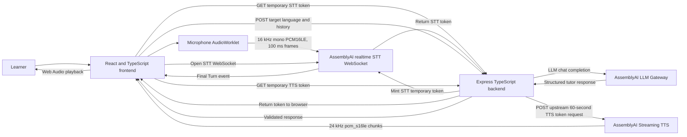

# LinguaLive

LinguaLive is a browser-based language-learning voice agent. A learner speaks an English request, receives a natural phrase in a selected target language with an explanation and pronunciation guidance, and can hear the target-language phrase spoken aloud.

Supported target languages:

- Spanish
- French
- German
- Italian

## Features

- Browser microphone capture with the Web Audio API and an AudioWorklet.
- AssemblyAI real-time STT with live partial and final transcripts.
- AssemblyAI LLM Gateway tutoring with structured target-language responses.
- Visual meaning, breakdown, phonetic guidance and usage tips.
- AssemblyAI TTS with Listen, Stop and Replay controls.
- Session-scoped STT `turn_order` deduplication.
- Separate temporary STT and TTS token flows, each configured with a 60-second connection-redemption window.

## Architecture



1. The React frontend requests microphone access and starts an `AudioContext`.
2. An AudioWorklet resamples mono browser audio to 16 kHz and emits 1,600-sample/3,200-byte PCM16LE frames.
3. `GET /api/assemblyai/token` securely asks AssemblyAI for a separate STT temporary token. The 60-second setting is the token redemption window for establishing the STT connection, not a limit on the lifetime of an already established session.
4. The browser connects to `wss://streaming.assemblyai.com/v3/ws` using that token and streams audio.
5. Partial `Turn` events update the live transcript. Final `Turn` events are deduplicated within the session and sent once to the tutor.
6. `POST /api/tutor/respond` sends the target language and capped conversation history to the AssemblyAI LLM Gateway.
7. The backend validates the complete structured response before returning it.
8. The frontend fetches a separate TTS temporary token through local `GET /api/assemblyai/tts-token`, opens `wss://tts.us.assemblyai.com/v1/ws`, and schedules streamed 24 kHz signed 16-bit PCM audio through `AudioContext`. The TTS token request's 60-second setting is the redemption window for opening the WebSocket, not the duration limit of an established session.

## Technology stack

- React 18
- TypeScript
- Vite
- Tailwind CSS
- Express
- Node.js
- Web Audio API and AudioWorklet
- AssemblyAI Realtime STT
- AssemblyAI LLM Gateway
- AssemblyAI Streaming TTS

## Prerequisites

- Node.js 20 or later is recommended.
- npm 10 or later is recommended.
- A working microphone.
- A current browser with `AudioContext`, `AudioWorklet`, WebSocket and Web Audio support.
- An AssemblyAI API key.

The package files do not declare an npm or Node.js `engines` constraint.

## Installation

From the repository root:

```bash
npm install
```

## Environment configuration

Create `server/.env`:

```bash
cp server/.env.example server/.env
```

On Windows PowerShell:

```powershell
Copy-Item server/.env.example server/.env
```

Set the following variables in `server/.env`:

| Variable | Purpose |
|---|---|
| `ASSEMBLYAI_API_KEY` | Server-only AssemblyAI key for STT tokens, LLM Gateway and TTS tokens. Obtain a key from the AssemblyAI dashboard. |
| `ASSEMBLYAI_LLM_MODEL` | Optional preferred LLM Gateway model. If absent or empty, the code defaults to `gpt-4.1`. |
| `PORT` | Express port; defaults to `3001`. |
| `CORS_ORIGIN` | Allowed browser origin; defaults to `http://localhost:5173`. |

The permanent key must remain in `server/.env` or the server environment. Never place it in frontend source or commit it.

The configured default model is `gpt-4.1`. When AssemblyAI returns an account-access error for that preferred model, the backend falls back once to `qwen3.5-4b-32k-fast`. The fallback is server-side and account-dependent. The live Gateway test included with this submission used `qwen3.5-4b-32k-fast` because the tested account did not have access to `gpt-4.1`; that test did not use GPT-4.1.

## Running locally

Start both frontend and backend:

```bash
npm run dev
```

The root command starts:

- Frontend: `http://localhost:5173`
- Backend: `http://localhost:3001`

Vite proxies `/api/*` requests to the Express server.

Start services separately in different terminals:

```bash
npm run dev:server
```

```bash
npm run dev:client
```

## Available scripts

Run these commands from the repository root.

| Command | Purpose |
|---|---|
| `npm run dev` | Start frontend and backend together. |
| `npm run dev:client` | Start the Vite frontend. |
| `npm run dev:server` | Start the Express server with `node --watch`. |
| `npm run build --workspace=client` | Type-check and build the frontend. |
| `npm run build --workspace=server` | Compile the backend to `server/dist`. |
| `npm run start --workspace=server` | Run the compiled backend server. |
| `npm run typecheck --workspace=server` | Type-check the backend without emitting output. |
| `npm run test --workspace=server` | Run Phase 3 target-language, history and response-validation tests. |
| `npm run test:stt-dedup` | Run synthetic final-`Turn` deduplication and session lifecycle tests. |
| `npm run test:audio-worklet` | Run synthetic AudioWorklet resampling and frame tests. |
| `npm run eval:test` | Run synthetic WER calculation tests. |
| `npm run eval:metrics` | Calculate metrics from the CSV template or a provider results CSV argument. |

The root `npm run build` currently builds only the frontend. Build the backend separately when validating a full submission.

## API endpoints

| Method | Endpoint | Purpose |
|---|---|---|
| `GET` | `/api/health` | Health check. |
| `GET` | `/api/assemblyai/token` | Mint a STT temporary token with a 60-second WebSocket redemption window. |
| `GET` | `/api/assemblyai/tts-token` | Mint a TTS temporary token with a 60-second WebSocket redemption window. |
| `POST` | `/api/tutor/respond` | Generate and validate a structured tutor response. |

## Evaluation

The evaluation framework in [`evaluation/`](./evaluation/) currently contains eight English-language pilot requests for Spanish, French, German and Italian. These represent a learner asking an English-speaking tutor how to express a phrase.

A fair comparison should use:

- The exact same recorded audio files for every provider.
- The same manually verified reference transcripts.
- Consistent encoding and sample-rate configurations wherever providers allow it.
- Separate run numbers for repeated tests.
- The same streaming timestamp basis for partial and final transcript latency.
- Recorded failures and timeouts rather than silently excluding them.

WER is calculated from normalised word sequences and corpus-level Levenshtein edits:

```text
(substitutions + deletions + insertions) / reference word count
```

Evaluation metrics cover WER, first partial latency, final transcript latency, real-time factor and success/failure rate. Recognition quality must remain separate from LLM tutor quality and TTS pronunciation quality.

The dataset contains planned cases with no completed recordings or benchmark results. It is an exploratory pilot, not statistically representative evidence and not a provider comparison.

See [`evaluation/README.md`](./evaluation/README.md) for the recording and analysis protocol.

## Security and design decisions

- The AssemblyAI API key remains server-side.
- STT and TTS temporary tokens are minted separately. Each 60-second value is the window for redeeming the token by establishing a WebSocket connection, not the maximum lifetime of an established session.
- Temporary tokens are returned to the browser; permanent credentials are never returned or logged.
- LLM output is parsed only as JSON and rejected unless all required fields and breakdown entries are present and correctly typed.
- STT Turn events are deduplicated by session-scoped `turn_order`; identical text on distinct turns remains distinct.
- Missing or invalid `turn_order` uses fail-open handling rather than text-based suppression.
- STT audio is mono 16 kHz signed 16-bit little-endian PCM in 100 ms frames.
- TTS uses 24 kHz `pcm_s16le` audio and Web Audio scheduling.

## Known limitations

- There is no completed head-to-head provider benchmark or completed evaluation recording set.
- STT has no automatic reconnection after network loss; the learner can restart the session.
- Missing or invalid `turn_order` values cannot always prevent duplicate delivery.
- TTS automatically requests a fresh token and reconnects once for selected close codes (`1008`, `3005` and `1012`). Other failures or repeated reconnection cases require manual retry; there is no general reconnection manager.
- This is a local reference implementation, not a production-hardened deployment.

## Project structure

```text
lingualive/
├── client/
│   ├── public/
│   └── src/
│       ├── components/
│       └── lib/
│           ├── useAssemblyAI.ts
│           ├── useMicrophone.ts
│           ├── useTextToSpeech.ts
│           ├── audioWorkletProcessor.ts
│           └── tutorApi.ts
├── server/
│   └── src/
│       ├── routes.ts
│       ├── index.ts
│       └── services/
│           └── llmGateway.ts
├── evaluation/
│   ├── README.md
│   ├── dataset/
│   ├── results/
│   ├── scripts/
│   └── templates/
├── scripts/
├── package.json
└── README.md
```
